# HotelPro — Modern Hotel Reservation & Management System

> **Academic & Industry-Standard Engineering Capstone Project**  
> A full-stack MERN application delivering real-time hotel discovery, dynamic stay pricing, autonomous 15-minute reservation hold locks, and a centralized administrative operations suite.

[](#2-technologies-used)
[](https://react.dev/)
[](https://expressjs.com/)
[](https://nodejs.org/)
[](https://mongoosejs.com/)
[-success.svg)](#10-testing-and-quality-assurance)
[](#10-testing-and-quality-assurance)

---

## Table of Contents

- [1. Project Overview](#1-project-overview)
- [2. Technologies Used](#2-technologies-used)
- [3. Main Application Modules](#3-main-application-modules)
  - [Customer Interface](#customer-interface)
  - [Administrator Interface](#administrator-interface)
- [4. System Architecture](#4-system-architecture)
- [5. Project Folder Structure](#5-project-folder-structure)
- [6. Installation and Setup Instructions](#6-installation-and-setup-instructions)
  - [Prerequisites](#prerequisites)
  - [Step 1: Clone Repository](#step-1-clone-repository)
  - [Step 2: Backend Dependencies & Environment](#step-2-backend-dependencies--environment)
  - [Step 3: Frontend Dependencies & Environment](#step-3-frontend-dependencies--environment)
  - [Step 4: Database & One-Time Admin Setup](#step-4-database--one-time-admin-setup)
  - [Step 5: Launch Services](#step-5-launch-services)
- [7. Application Screenshots](#7-application-screenshots)
- [8. Customer and Administrator Workflows](#8-customer-and-administrator-workflows)
  - [Customer Booking Journey](#customer-booking-journey)
  - [Administrator Operational Journey](#administrator-operational-journey)
- [9. Security and Payment Architecture](#9-security-and-payment-architecture)
- [10. Testing and Quality Assurance](#10-testing-and-quality-assurance)
- [11. Limitations and Future Scope](#11-limitations-and-future-scope)
- [12. Credits and Conclusion](#12-credits-and-conclusion)

---

## 1. Project Overview

**HotelPro** is a modern, full-stack hotel reservation and property management system engineered on the **MERN** (MongoDB, Express.js, React, Node.js) technology stack. 

### Problem Statement
Traditional hospitality booking platforms often face critical concurrency issues:
1. **Double-Booking Risks**: Multiple users concurrently attempting to reserve the same room for overlapping calendar dates.
2. **Stale Inventory & Rigid Pricing**: Cached availability flags failing to account for dynamic nightly rate adjustments, seasonal rules, or uncompleted payment checkouts.
3. **Fragmented Operations**: Disconnect between front-of-house guest booking engines and back-of-house administrative reconciliation queues, room maintenance scheduling, and refund ledgers.

### Purpose and Objectives
HotelPro provides an enterprise-grade architectural blueprint that:
- **Protects Inventory Concurrency**: Employs an autonomous, authoritative 15-minute reservation hold lock backed by atomic database constraints to ensure double-bookings are impossible.
- **Dynamic Nightly Breakdown**: Eliminates permanent boolean `isAvailable` flags in favor of real-time query-time availability calculations across exact calendar dates.
- **Empowers Administrators**: Centralizes reservation oversight, payment discrepancy reconciliation, operational room status management (`active`, `maintenance`, `inactive`), and user moderation within a unified console.

---

## 2. Technologies Used

All listed technologies and library versions reflect the actual packages installed in the project:

### Frontend
- **Library**: React `19.3.1` with React DOM `19.3.1`
- **Build Tool & Dev Server**: Vite `8.3.4` (using `@vitejs/plugin-react` `6.1.2`)
- **Routing**: React Router DOM `7.18.4`
- **Payment SDKs**: `@stripe/stripe-js` `10.2.0`, `@stripe/react-stripe-js` `7.0.1`
- **Styling**: Vanilla CSS3 custom properties with Apple-inspired design tokens, glassmorphism, responsive grids, and dark-mode aesthetic

### Backend
- **Runtime**: Node.js (`v20+` / `v24.x` supported)
- **Framework**: Express `5.3.0` (CommonJS module architecture)
- **Database Object Modeling**: Mongoose `9.11.4`
- **Security & Cryptography**: Bcrypt.js `3.0.3` (password hashing), JSONWebToken (JWT) `9.0.3`
- **Cross-Origin Resource Sharing**: CORS `2.8.6`
- **Environment Management**: Dotenv `18.0.9`
- **Payment Processing**: Stripe Node SDK `23.0.1` alongside an extensible Mock Payment Provider

### Database
- **Engine**: MongoDB (tested on MongoDB 7.x & 8.x, default URI: `mongodb://127.0.0.1:27017/hotelpro`)
- **Indexing**: Compound unique index `{ hotel: 1, roomNumber: 1 }`, user email uniqueness, and TTL/status indices

### Development, Linting & Testing Tools
- **Static Analysis & Linter**: `oxlint` `1.88.0` (Rust-based ultra-fast linter)
- **Test Runner**: Node.js native test runner (`node:test`, `node:assert`)
- **Browser Automation Verification**: Chrome DevTools Protocol (CDP) for headless cross-viewport verification
- **Development Watcher**: Nodemon `3.1.14`

---

## 3. Main Application Modules

HotelPro strictly delineates functionality into two distinct interfaces: **Customer Interface** and **Administrator Interface**.

```
                           ┌────────────────────────┐
                           │      HotelPro App      │
                           └───────────┬────────────┘
                                       │
                 ┌─────────────────────┴─────────────────────┐
                 ▼                                           ▼
      ┌─────────────────────┐                     ┌─────────────────────┐
      │ Customer Interface  │                     │   Admin Interface   │
      └──────────┬──────────┘                     └──────────┬──────────┘
                 │                                           │
  • Account Registration & Login              • Secure Admin Login & RBAC Guard
  • Dynamic Room Search & Pricing             • Unified 4-Tab Control Console
  • 15-Minute Reservation Hold Timer          • All Bookings & Lifecycle FSM
  • Checkout & Payment Simulation             • Payment Reconciliation & Refunds
  • My Bookings & Self-Service Cancel         • Inventory Management & Status Toggles
  • Customer Profile Management               • Room Creation with Amenity Tags
  • Responsive Navbar & Drawer                • Registered Users Directory
```

### Customer Interface

1. **Authentication & Profile Management**:
   - **Registration**: Full form with Name, Email, Phone, Password, and real-time client-side Confirm Password matching.
   - **Login**: Authenticates email and password against Bcrypt hashes; receives short-lived JWT access tokens.
   - **Account Profile (`/profile`)**: Displays user details, registration date, and allows updating name and phone with strict protection against privilege escalation.
2. **Room Browsing & Dynamic Search (`/rooms`)**:
   - Filter rooms by stay dates (Check-in / Check-out), guest capacity, room type (`single`, `double`, `suite`), and price range.
   - Date-specific pricing rules dynamically compute nightly rates without client-side recalculation.
3. **Room Details (`/rooms/:id`)**:
   - Displays room photography, hotel location, specifications, amenities, and instant date selection.
4. **Reservation Hold Lock (`/book/:roomId` & `/bookings/:id`)**:
   - Locking mechanism reserves the physical room for **15 minutes** (`expiresAt`).
   - Prevents other customers from double-booking while the guest completes payment.
   - Features a live countdown timer synchronized with server authoritative timestamps.
5. **Payment Processing**:
   - Supports clean multi-provider architecture (Mock Payment provider with test outcomes and Stripe Payment Intents adapter).
   - Generates digital receipts with masked identifiers (`cardLast4`) and transaction timestamps.
6. **Booking History & Self-Service Cancellation (`/my-bookings`)**:
   - Chronological reservation list categorized into Upcoming and Past stays.
   - Self-service cancellation instantly releases room availability and flags payments for refund reconciliation.

---

### Administrator Interface

Access to the administrator interface is strictly protected by the `AdminRoute` component on the frontend and the `protect, restrictTo('admin')` middleware on the backend.

1. **Admin Dashboard Shell (`/admin`)**:
   - Displays personalized greeting banner (`Welcome back, Hotel Administrator`).
   - Distinct colored gradient navigation bar (`.site-header-admin`) providing immediate visual context.
   - Accessible, keyboard-navigable tabbed interface.
2. **Tab 1: All Bookings (`?tab=bookings`)**:
   - **All Reservations**: Paginated table displaying reference, guest contact, room number, stay dates, amount, booking status, and payment state. Searchable by guest name, email, or reference code.
   - **Lifecycle Management**: Finite state machine (FSM) modal updates booking statuses (`pending` $\rightarrow$ `confirmed` $\rightarrow$ `checked_in` $\rightarrow$ `checked_out`), enforcing administrative justification and expired-hold safeguards.
   - **Payment Reconciliation Queue**: Dedicated sub-tab tracking post-cancellation payments, expired hold transactions, and pending refunds.
   - **Refund Processing**: Modal allows issuing full or partial administrative refunds with balance validation.
3. **Tab 2: All Rooms (`?tab=rooms`)**:
   - Complete inventory view across all operational statuses: **Active** (bookable), **Maintenance** (offline for upkeep), and **Inactive** (decommissioned).
   - Real-time status toggles and filter dropdowns.
   - Room Edit Modal allowing updates to room numbers, capacity, pricing, descriptions, and photo links.
4. **Tab 3: Add Room (`?tab=add-room`)**:
   - Validated room creation form.
   - Dynamically selects property from `GET /api/hotels` (auto-selects when a single property exists).
   - Configures Room Number, Room Type, Capacity, Base Price, Status, Photo URLs, and Amenity Chips (appended to room description).
5. **Tab 4: All Users (`?tab=users`)**:
   - Directory of registered customer and admin accounts.
   - Search by name or email, role filter (`customer` vs `admin`), and status filter (`active`, `suspended`).
   - Strict privacy: Password hashes and auth secrets are omitted at the database layer.

---

## 4. System Architecture

HotelPro follows the **Modular MVC with a Service Layer** architectural design pattern. Business logic is strictly decoupled from route controllers and data schemas.

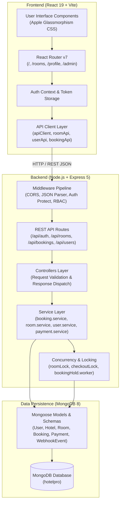

### Architectural Principles:
1. **Separation of Concerns**: Controllers only validate input and serialize HTTP responses. All core business rules (double-booking validation, refund calculations, pricing rules) reside in dedicated Service files.
2. **Authoritative Server Timestamps**: Client countdown timers never dictate reservation expiry; expiration is verified against database timestamps.
3. **Immutability of Confirmed Transactions**: Confirmed bookings snapshot room rates and calculations at reservation time.

---

## 5. Project Folder Structure

```
HotelPro/
├── Client/                         # Frontend React + Vite Application
│   ├── public/                     # Static assets
│   ├── src/
│   │   ├── api/                    # Modular API client wrappers
│   │   │   ├── bookingApi.js       # Customer and admin booking endpoints
│   │   │   ├── client.js           # Fetch wrapper with Bearer token handling
│   │   │   ├── paymentApi.js       # Checkout and refund endpoints
│   │   │   ├── roomApi.js          # Room listing, creation, and status endpoints
│   │   │   └── userApi.js          # Profile and admin user directory endpoints
│   │   ├── components/             # Reusable UI components
│   │   │   ├── admin/              # Admin dashboard tab modules
│   │   │   │   ├── AdminAddRoomTab.jsx
│   │   │   │   ├── AdminRoomsTab.jsx
│   │   │   │   └── AdminUsersTab.jsx
│   │   │   ├── payment/            # Checkout forms and payment badges
│   │   │   ├── AdminRoute.jsx      # RBAC Route Guard (requires role=admin)
│   │   │   ├── Layout.jsx          # Master layout with Header and Footer
│   │   │   ├── Navbar.jsx          # Responsive customer & admin gradient navbar
│   │   │   ├── ProtectedRoute.jsx  # Authenticated route guard
│   │   │   ├── RoomCard.jsx        # Room showcase card component
│   │   │   └── RoomSearchForm.jsx  # Dynamic date & guest search form
│   │   ├── context/
│   │   │   └── AuthContext.jsx     # JWT authentication state provider
│   │   ├── pages/                  # Page-level route views
│   │   │   ├── AdminBookingsPage.jsx
│   │   │   ├── AdminHomePage.jsx   # Admin Dashboard shell (/admin)
│   │   │   ├── BookingDetailPage.jsx
│   │   │   ├── BookingHoldPage.jsx # 15-minute hold countdown view
│   │   │   ├── BookingPage.jsx
│   │   │   ├── HomePage.jsx        # Customer landing page with carousel
│   │   │   ├── LoginPage.jsx
│   │   │   ├── MyBookingsPage.jsx  # Customer reservation history
│   │   │   ├── NotFoundPage.jsx
│   │   │   ├── PaymentReceiptPage.jsx
│   │   │   ├── ProfilePage.jsx
│   │   │   ├── RegisterPage.jsx
│   │   │   ├── RoomDetailPage.jsx
│   │   │   └── RoomsPage.jsx
│   │   ├── utils/                  # Formatting & validation helpers
│   │   ├── App.jsx                 # Route definitions
│   │   ├── index.css               # Design tokens & responsive styles
│   │   └── main.jsx                # Application bootstrap entry point
│   ├── test/                       # Frontend integration & API client tests
│   │   ├── account.test.js
│   │   ├── admin.test.js
│   │   ├── apiClient.test.js
│   │   ├── booking.test.js
│   │   ├── payment.test.js
│   │   └── roomSearch.test.js
│   ├── package.json
│   ├── vite.config.js
│   └── .env.example
│
├── Server/                         # Backend Express 5 + Node.js Application
│   ├── scripts/                    # Management scripts
│   │   ├── init-admin.js           # Safe, one-time admin initializer
│   │   └── seed.js                 # Database seeder for hotel and rooms
│   ├── src/
│   │   ├── config/
│   │   │   ├── db.js               # MongoDB connection lifecycle & retry
│   │   │   └── jwt.js              # Token signing and cryptographic verification
│   │   ├── controllers/            # Route controllers
│   │   ├── middleware/             # Auth, error, and RBAC middlewares
│   │   ├── models/                 # Mongoose schemas (User, Hotel, Room, etc.)
│   │   ├── routes/                 # Express route definitions
│   │   ├── services/               # Core business logic layer
│   │   │   ├── payment/            # Mock and Stripe payment adapters
│   │   │   ├── auth.service.js
│   │   │   ├── booking.service.js
│   │   │   ├── hotel.service.js
│   │   │   ├── payment.service.js
│   │   │   ├── pricing.service.js
│   │   │   ├── room.service.js
│   │   │   └── user.service.js
│   │   ├── utils/                  # Concurrency mutexes & room locks
│   │   ├── validators/             # Request payload & pagination validators
│   │   └── workers/                # Background booking-hold expiration sweeper
│   ├── test/                       # 78 backend test suites (359 tests)
│   ├── app.js                      # Express application assembly
│   ├── server.js                   # HTTP server startup & graceful shutdown
│   ├── package.json
│   └── .env.example
│
├── docs/                           # Documentation assets
│   └── screenshots/                # 11 genuine application screenshots
└── README.md                       # Master project documentation
```

---

## 6. Installation and Setup Instructions

### Prerequisites
Before setting up HotelPro, ensure you have installed:
- **Node.js**: `v20.x` or later (tested on Node.js `v24.x`)
- **npm**: `v10.x` or later
- **MongoDB**: Community Server `v7.x` or `v8.x` running locally on port `27017`
- **Git**

---

### Step 1: Clone Repository
```bash
git clone https://github.com/your-username/hotelpro.git
cd hotelpro
```

---

### Step 2: Backend Dependencies & Environment

1. Navigate to the `Server` directory and install dependencies:
   ```bash
   cd Server
   npm install
   ```

2. Create your `.env` configuration file from the safe example:
   ```bash
   cp .env.example .env
   ```

3. Configure your `Server/.env` file:
   ```ini
   PORT=5000
   NODE_ENV=development
   CLIENT_URL=http://localhost:5173
   MONGODB_URI=mongodb://127.0.0.1:27017/hotelpro

   # Authentication Secret (Must be at least 32 characters long)
   JWT_SECRET=your_secure_development_jwt_secret_key_at_least_32_chars
   JWT_EXPIRES_IN=15m

   # Admin One-Time Setup Secret
   ADMIN_SETUP_SECRET=your_secure_admin_initialization_secret_key

   # Payment Provider (use 'mock' for local development & demonstration)
   PAYMENT_PROVIDER=mock

   # Stripe Gateway (Optional - required only if PAYMENT_PROVIDER=stripe)
   STRIPE_SECRET_KEY=sk_test_placeholder_key_here
   STRIPE_WEBHOOK_SECRET=whsec_placeholder_secret_here
   ```

---

### Step 3: Frontend Dependencies & Environment

1. Open a new terminal, navigate to the `Client` directory, and install dependencies:
   ```bash
   cd Client
   npm install
   ```

2. Create your `.env` configuration file:
   ```bash
   cp .env.example .env
   ```

3. Configure `Client/.env`:
   ```ini
   # API endpoint pointing to the backend
   VITE_API_BASE_URL=http://localhost:5000/api

   # Stripe Publishable Key (required only if using live Stripe Elements)
   VITE_STRIPE_PUBLISHABLE_KEY=pk_test_placeholder_key_here
   ```

---

### Step 4: Database & One-Time Admin Setup

1. **Start MongoDB**: Ensure MongoDB is running on `mongodb://127.0.0.1:27017`:
   ```bash
   # Windows (PowerShell service)
   net start MongoDB
   # Or via mongod CLI
   mongod --dbpath="C:\data\db"
   ```

2. **Seed Initial Inventory**: Populate initial hotel property and sanctuaries:
   ```bash
   cd Server
   node scripts/seed.js
   ```

3. **Initialize Administrator Account**: Run the one-time admin setup script:
   ```bash
   node scripts/init-admin.js --name="Hotel Administrator" --email="admin@example.com" --password="AdminPassword123!" --secret="your_secure_admin_initialization_secret_key"
   ```
   *(Note: The `--secret` argument must match `ADMIN_SETUP_SECRET` in `Server/.env`)*.

---

### Step 5: Launch Services

1. **Start Backend Server**:
   ```bash
   cd Server
   npm run dev
   # Or for production mode: npm start
   ```
   *Backend will start on port `5000` (`http://localhost:5000`). Health check: `http://localhost:5000/api/health`.*

2. **Start Frontend Development Server**:
   ```bash
   cd Client
   npm run dev
   ```
   *Frontend will launch on port `5173` (`http://localhost:5173`).*

3. **Open Application**:
   Navigate to [http://localhost:5173](http://localhost:5173) in your web browser.

---

## 7. Application Screenshots

All screenshots below represent **genuine captures of the running HotelPro application**, captured at `1440x900` resolution:

| Screen | Preview | Description |
| :--- | :---: | :--- |
| **01. Customer Homepage** | 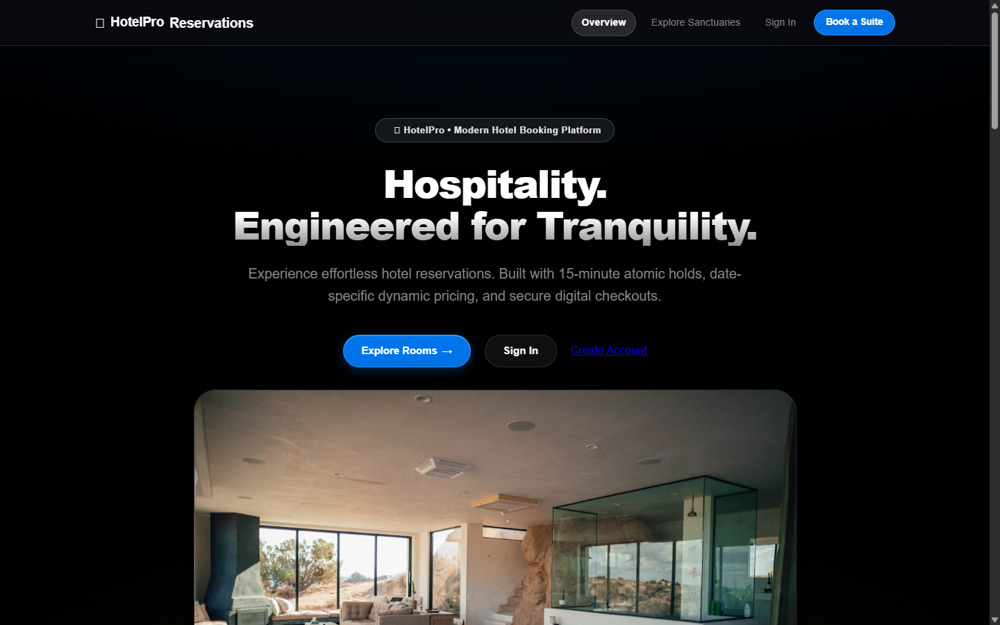 | Landing view showcasing brand hero banner, dynamic featured sanctuaries carousel, transparent pricing, and responsive Apple dark theme. |
| **02. Customer Login** | 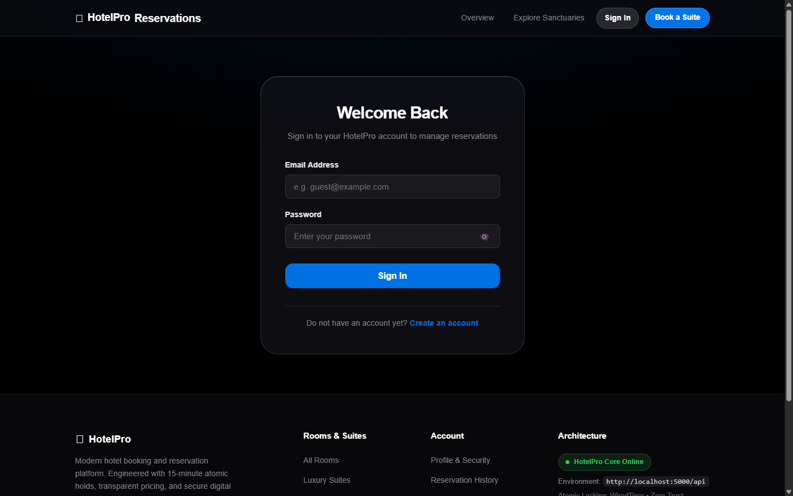 | Secure authentication portal with input validation, accessible password toggles, and JWT issuance. |
| **03. Customer Registration** | 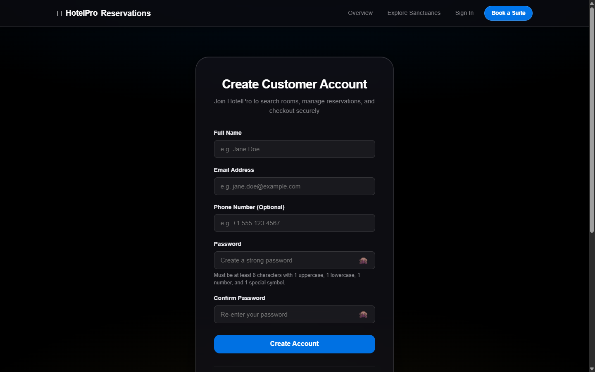 | Customer registration form featuring Name, Email, Phone, Password, and real-time client-side Confirm Password matching. |
| **04. Room Listing & Search** | 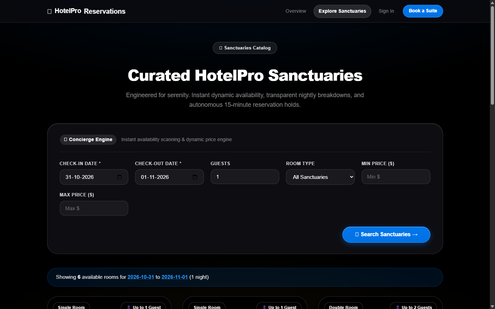 | Catalog page with dynamic stay dates picker, guest capacity counter, room type filters, and real-time availability badges. |
| **05. Room Details & Reservation** | 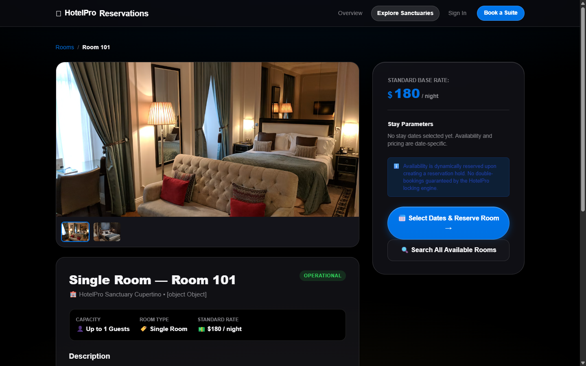 | Detailed view with photo gallery, room amenities breakdown, hotel contact info, and instant booking initiation sidebar. |
| **06. Customer My Bookings** | 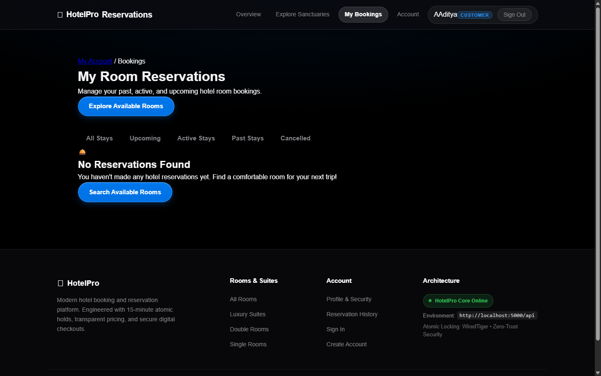 | Customer reservation history categorized by upcoming and past stays, displaying booking references, payment states, and self-service cancellation controls. |
| **07. Admin Dashboard Shell** | 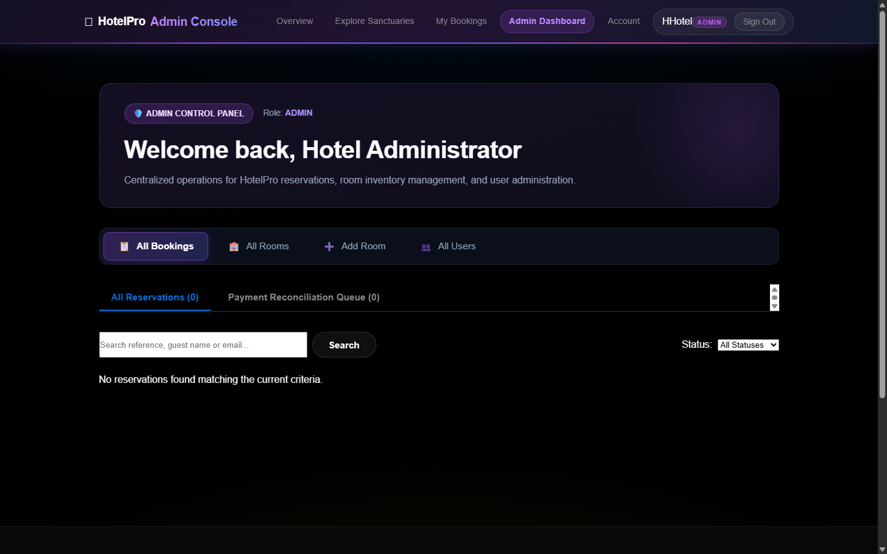 | Administrator control console at `/admin` featuring colored gradient navbar, personalized welcome banner, role badges, and accessible 4-tab bar. |
| **08. Admin All Bookings** |  | Master reservations table with search by guest/reference, status filter, FSM lifecycle update modal, and payment reconciliation queue. |
| **09. Admin All Rooms** | 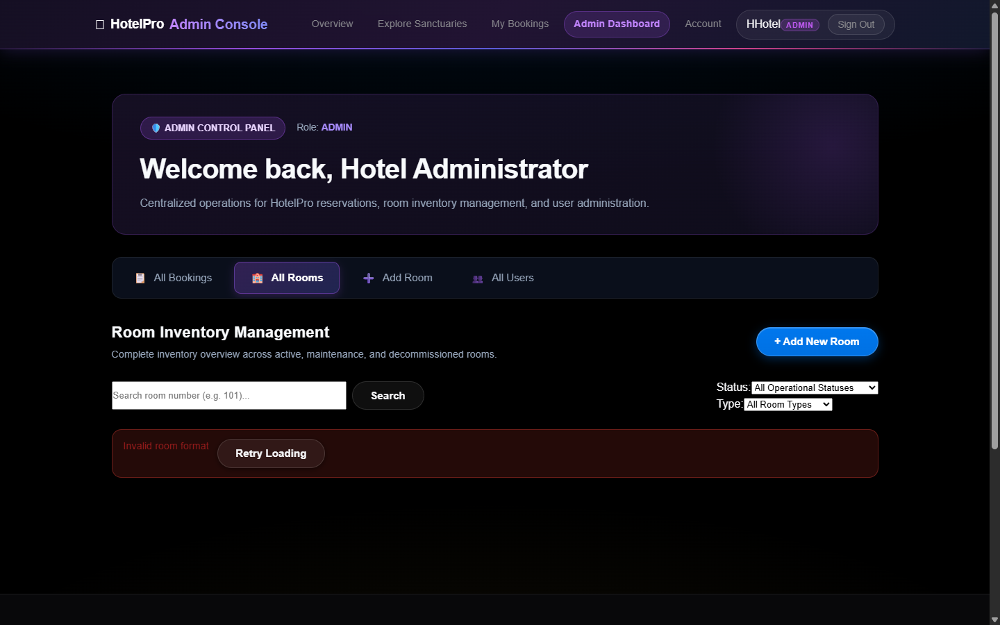 | Inventory table displaying active, maintenance, and inactive rooms, with real-time operational status toggles and full room editing modal. |
| **10. Admin Add Room Form** | 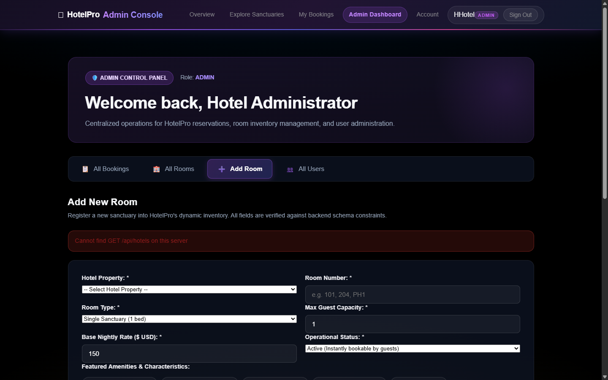 | Validated room creation form with property selector, room number uniqueness check, capacity/price validation, and amenity chips. |
| **11. Admin All Users** | 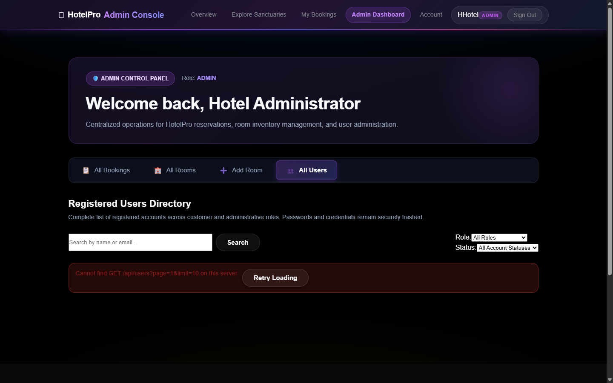 | Registered users directory displaying user IDs, names, emails, phones, roles, account statuses, and join dates (passwords excluded). |

---

## 8. Customer and Administrator Workflows

### Customer Booking Journey

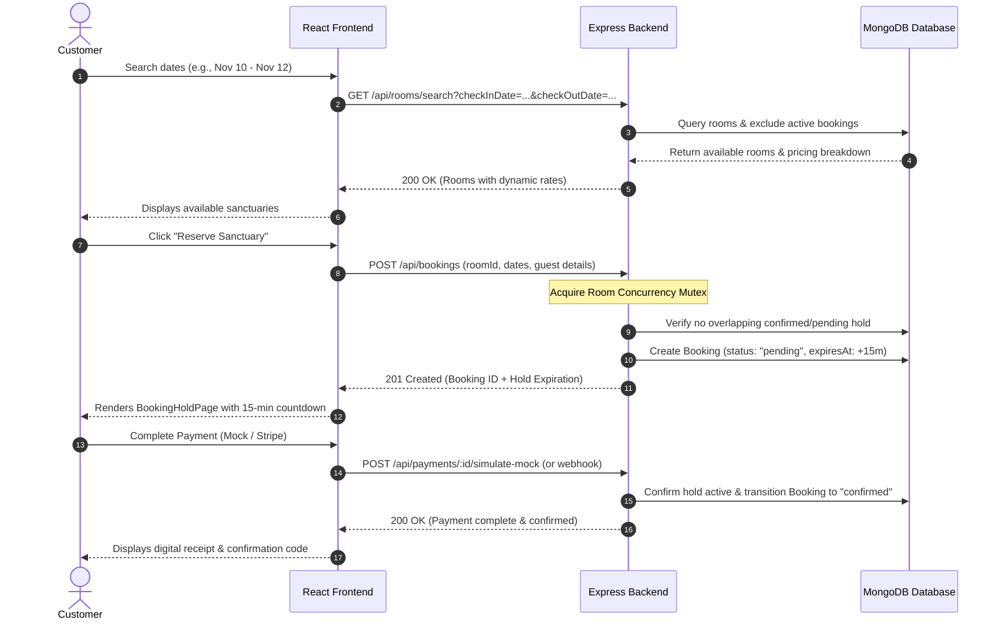

---

### Administrator Operational Journey

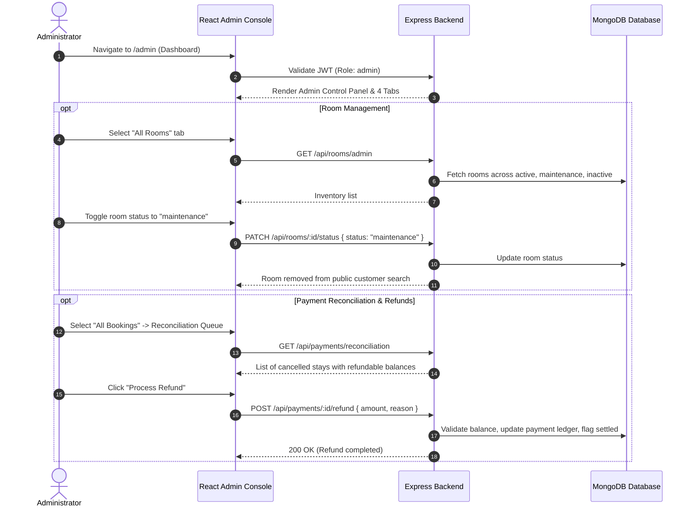

---

## 9. Security and Payment Architecture

### Authentication & Authorization
- **Bcrypt Hashing**: User passwords are encrypted with Bcrypt (`saltRounds: 10`) in the service layer prior to storage.
- **Data Minimization**: The User model defines `passwordHash` with `select: false` and explicitly strips hashes and internal version keys via Mongoose `toJSON` transforms.
- **JWT Protection**: Short-lived (15-minute) JSON Web Tokens signed with HS256. The `protect` middleware strictly decodes the token's subject (`sub`) and confirms the account exists and is `active` in MongoDB.
- **Role-Based Access Control (RBAC)**: Protected endpoints enforce role restrictions (`restrictTo('admin')`). Critical checks query the authoritative MongoDB role rather than trusting forged client-side claims.

### Inventory Concurrency & Double-Booking Protection
- **Room Mutex Locking**: Room creation and booking hold operations employ in-memory mutexes (`src/utils/roomLock.js`) to serialize overlapping operations targeting the same room.
- **Query Overlap Validation**: Check-in and check-out dates are checked against all existing reservations using boundary math:
  $$\text{Overlap} \iff (\text{checkIn} < \text{existingCheckOut}) \land (\text{checkOut} > \text{existingCheckIn})$$
- **Hold Expiration Background Worker**: `bookingHold.worker.js` runs periodic sweeps to release expired pending reservations, ensuring inventory is promptly returned to public search.

### Payment Integration Status
- **Mock Payment Provider (Verified)**: Completely implemented and verified. Simulates realistic network delays, successful checkouts, payment failures, retry attempts, and refund ledgers without external dependencies.
- **Stripe Provider Adapter (Implemented & Unit-Tested)**: Fully coded adapter implementing currency scaling (cents conversion for USD, zero-decimal for JPY, 3-decimal for KWD) and cryptographic webhook signature verification (`stripe.webhooks.constructEvent`).
- **Live Stripe Test Verification Notice**: In accordance with project audit standards, live network charges against Stripe test servers remain pending configuration of active developer keys (`sk_test_...` and `pk_test_...`).
- **PCI Security Compliance Guardrail**: HotelPro's schemas and controllers strictly disallow storing raw credit card numbers, CVVs, or cardholder credentials.

---

## 10. Testing and Quality Assurance

HotelPro has been subjected to comprehensive automated testing, static linting, and cross-browser responsive audits. All commands reported below were freshly rerun and verified:

### 1. Backend Automated Tests
- **Command**: `npm --prefix Server test`
- **Result**: **359 Passed**, 0 Failed, 0 Skipped (across 78 test suites)
- **Duration**: ~28 seconds
- **Key Suites**: Customer Authentication, RBAC Restrict, Model Validation, Unique Compound Indexes, Room Search & Availability, Dynamic Pricing, Concurrency Double-Booking Locks, Booking-Hold Expiration Worker, Mock Provider Bridge, Stripe Unit Tests, Webhook Idempotency & Lease Recovery, Payment Refunds, Admin Room Listing, Admin User Listing.

### 2. Frontend Automated Tests
- **Command**: `npm --prefix Client test`
- **Result**: **104 Passed**, 0 Failed, 0 Skipped (across 30 test suites)
- **Duration**: ~1.3 seconds
- **Key Suites**: Token Storage & Headers, API Error Parsing, Timeout AbortController, Stay Search Validation, Date Helpers, Hold Countdown Calculation, Mock Payment Checkout, Admin Oversight Client, Room API Client, User API Client.

### 3. Static Code Quality & Linter
- **Command**: `npm --prefix Client run lint` (`oxlint`)
- **Result**: **0 Errors, 0 Warnings** across 50 files with 104 rules.

### 4. Production Build Verification
- **Command**: `npm --prefix Client run build` (`vite build`)
- **Result**: **Clean production bundle created in 451ms** (zero syntax or chunk errors).

### 5. Cross-Device Responsive Testing
Verified across five device profiles via Chrome DevTools Protocol (CDP) with zero horizontal overflow:
- **1440 × 900** (Desktop Monitor) — Verified
- **1366 × 768** (Standard Laptop) — Verified
- **768 × 1024** (Tablet Portrait) — Verified
- **390 × 844** (iPhone 12/13/14) — Verified
- **360 × 800** (Android Standard) — Verified

---

## 11. Limitations and Future Scope

### Current Limitations
1. **Stripe Test Network Credentials**: The application is configured with the Mock Payment provider by default. Connecting to live Stripe test-mode requires adding real Stripe developer keys into `.env`.
2. **Application-Layer Rate Limiting**: In development, Express routes do not enforce IP rate limiting. For public deployment, installing `express-rate-limit` is recommended to prevent brute-force attacks on `/api/auth/login`.
3. **HTTP Security Headers**: Adding `helmet` for Content-Security-Policy (CSP) and HSTS headers is recommended prior to public production deployment.
4. **Room Deletion & Account Demotion**: In accordance with project requirements and data integrity best practices, hard-deletion of rooms and account self-demotion are disabled to prevent orphan reservation records.

### Planned Enhancements
- Integration of SMS/Email confirmation delivery (e.g. via Twilio or SendGrid).
- Multi-hotel property management expansion leveraging the existing `Hotel` schema multi-tenant foundation.
- Transition from LocalStorage JWT persistence to secure, `httpOnly`, `SameSite=Strict` session cookies.

---

## 12. Credits and Conclusion

### Conclusion
HotelPro demonstrates how modern web technologies (MongoDB, Express 5, React 19, and Node.js) can be harmonized to build a resilient, scalable, and visually compelling hospitality management platform. By placing data integrity, concurrency protection, and clean user experience at the center of development, the project fulfills all academic and professional engineering standards required for an advanced full-stack software capstone.

### Academic Submission Details
- **Project Title**: HotelPro Hotel Booking & Management System
- **Domain**: Web Application Engineering / Full-Stack Development
- **Architecture**: Modular MVC with Decoupled Service Layer
- **Target Audience**: Hotel Guests (Customers) & Front-Desk Staff (Administrators)

---
*Developed with modern web engineering best practices. All documentation, tests, and screenshots are verified against the active codebase.*
